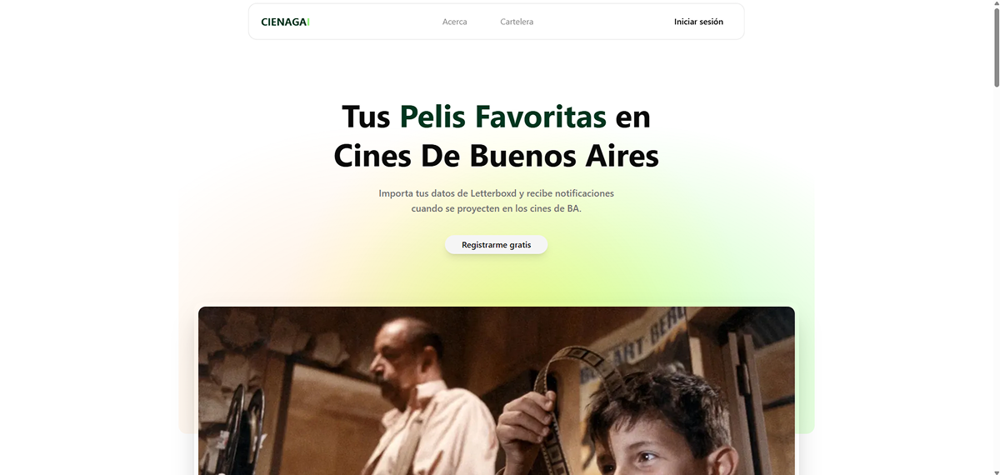

<p align="center">

</p>

<h1 align="center">🌊 Ciénaga</h1>

<p align="center">Aplicación web que te avisa cuando en los cines de Buenos Aires se proyectan películas de directores que te gustan.</p>

<p align="center">
  <a href="#-características-principales">Características</a> •
  <a href="#-cómo-funciona">Cómo funciona</a> •
  <a href="#-instalación">Instalación</a> •
  <a href="#-arquitectura">Arquitectura</a>
</p>

---

## 🚀 Características principales

- **Importar historial de Letterboxd**: Sube tus archivos `watched.csv` y `ratings.csv`
- **Extracción automática de directores**: Sistema de scraping que obtiene directores, posters, y metadatos desde Letterboxd
- **Scraping de carteleras**: Monitoreo automático de cines porteños con datos detallados (horarios, salas, precios)
- **Lista de funciones**: Scraping semanal de la [lista de Letterboxd](https://letterboxd.com/lamateroric/list/funciones-en-buenos-aires/) con cines nuevos descubiertos automáticamente
- **Seguimiento inteligente**: Automáticamente identifica directores favoritos basado en tu historial
- **Notificaciones personalizadas**: Te avisa por email cuando hay películas de directores que seguís
- **Dashboard rico**: Muestra coincidencias con información completa de eventos
- **Cartelera pública**: Mejores películas en cartelera sin necesidad de registro

---

## 🔄 Cómo funciona

### 1. **Importación y procesamiento**

- Subís tu CSV exportado de Letterboxd
- Se crean automáticamente las relaciones usuario-película-director
- Sistema inteligente evita duplicados y mantiene consistencia

### 2. **Scraping automatizado** (GitHub Actions)

- **Directores y metadatos**: Extrae información completa desde Letterboxd (directors, posters, ratings)
- **Carteleras detalladas**: Procesa eventos de cada cine con fechas, horarios, salas y descripciones
- **Sincronización**: Mantiene actualizada la relación usuario-directores automáticamente

### 3. **Matching y experiencia personalizada**

- Cruza tus directores favoritos con la programación actual
- Dashboard con filtros avanzados (fecha, cine, rating, horarios)
- Notificaciones por email de coincidencias relevantes

---

## 📂 Arquitectura

### Scripts automatizados

```
scripts/
├── scrape-directors.ts           # Scraping de perfiles de directores (avatar, bio, tmdb_id)
├── scrape-movie-data.ts          # Scraping de películas (asigna directores y metadatos)
├── scrape-screenings.ts          # Orchestrator de carteleras
├── scrape-list.ts                # Scraping de lista Letterboxd (funciones en Buenos Aires)
├── send-notifications.ts         # Envío de notificaciones por email
└── services/
    ├── movie-data/               # Pipeline películas → directores
    │   ├── api.director.service.ts
    │   ├── batch-processor.service.ts
    │   └── letterboxd-scraper.service.ts
    ├── list/                     # Parser de notas de la lista Letterboxd
    │   └── list-note-parser.ts
    ├── notifications/            # Agrupación y envío de emails
    │   ├── email.service.ts
    │   ├── notification.service.ts
    │   └── template.builder.ts
    └── screenings/               # Scrapers específicos por cine
        ├── base-scraper.service.ts
        ├── malba.scraper.ts
        ├── lumiton.scraper.ts
        └── scraper.factory.ts    # Mapea slug del cine → scraper
```

---

## ⚙️ Instalación

### Prerrequisitos

- Node.js 24+
- pnpm
- Cuenta de Supabase
- Cuenta de GitHub (para Actions)

### Setup local

```bash
git clone https://github.com/brandonporcel/cienaga.git
cd cienaga
pnpm install
```

### Variables de entorno

Crear `.env.local`:

```bash
NEXT_PUBLIC_SUPABASE_URL=tu_supabase_url
NEXT_PUBLIC_SUPABASE_ANON_KEY=tu_anon_key
SUPABASE_SERVICE_ROLE_KEY=tu_service_role_key

CRON_SECRET_KEY=tu_clave_secreta_para_cron

RESEND_API_KEY=tu_resend_key
```

### Base de datos

```bash
# Importar schema y datos iniciales
psql -f db/schema.sql
psql -f db/seed.sql
```

### GitHub Actions

1. Ir a Settings → Secrets and variables → Actions
2. Agregar secrets:
   - `APP_URL`: URL de tu app desplegada
   - `CRON_SECRET_KEY`: Misma clave del .env

### Desarrollo

```bash
pnpm dev                          # Servidor de desarrollo
pnpm scrape:director-profiles     # Probar scraping de perfiles
pnpm scrape:letterboxd-list       # Probar scraping de lista Letterboxd
pnpm type-check                   # Verificar TypeScript
```

---

## 🎬 Cines y cartelera

La app incluye una [pantalla pública de cines](/cinemas) con mapa, donde cada cine tiene su página con dirección, link al sitio y sus próximas funciones. La cartelera se arma con la [lista de funciones en Buenos Aires](https://letterboxd.com/lamateroric/list/funciones-en-buenos-aires/) de **[@lamateroric](https://letterboxd.com/lamateroric/)**: un scraping semanal (GitHub Actions) descubre los cines y sus funciones automáticamente, y cada cine detectado queda disponible en la app. Los cines con scraper dedicado (Malba, Lumiton, etc.) aportan funciones con horarios y salas detalladas.

Algunos de los espacios alcanzados: MALBA, Cine Lorca, CCK, Cine Arte Cacodelphia, Centro Cultural Recoleta, Cine Gaumont y decenas de cineclubes porteños.

---

## 🏗️ Stack

- Next.js - Supabase (PostgreSQL, Auth, Storage) - GitHub Actions - Resend

---

## 📋 To-Do

- [ ] Docker
- [ ] Tests
- [ ] Agregar personalizacion para banda temporal para recibir de notificaciones. Screenings dentro de las proximos x horas/dias.

---

## 🤝 Contribuir

Si tienes ideas o mejoras, no dudes en hacer un fork del proyecto y enviar un pull request.

---

## 📞 Feedback

Me encantaría conocer tu opinión sobre el proyecto. Puedes enviarme un [email](https://mail.google.com/mail/?view=cm&fs=1&to=brandon7.7porcel@gmail.com&su=Cienaga) o a través de [LinkedIn](https://www.linkedin.com/in/brandonporcel/).
